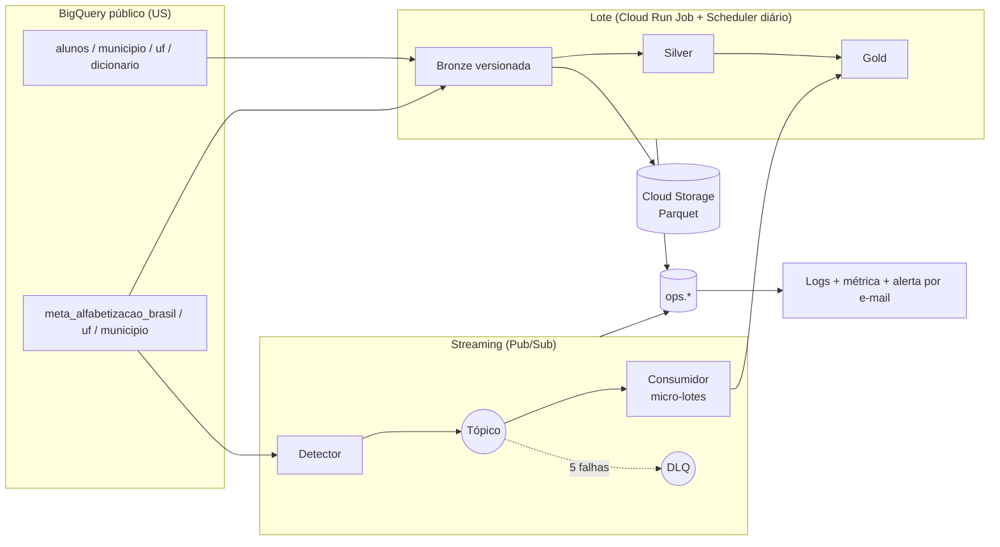

# Radar da Alfabetização

Pipeline híbrido (lote + streaming) sobre os dados oficiais do INEP para acompanhar o indicador
**Criança Alfabetizada** (Saeb, corte de proficiência 743) frente à meta de **80% em 2030** na rede pública.

> Entregável da Fase 2 do Tech Challenge (FIAP Pós Tech, *AI Scientist*).
> Fonte: `basedosdados.br_inep_avaliacao_alfabetizacao` (BigQuery, região US).

## O que o pipeline entrega

| Entrega | Onde |
|---|---|
| Termômetro: resultado × meta de cada município, UF e Brasil, com cinco estados explícitos | `gold.termometro` |
| Validação cruzada: taxa recalculada dos microdados × taxa oficial | `gold.reconciliacao` |
| Anomalias e selo de confiança por município | `gold.indicador_municipal` |
| Base da Fase 3, com atributos e rótulos **separados** (sem vazamento do alvo) | `gold.ml_features`, `gold.ml_labels` |
| Evidência de cada execução (jobs, linhas, bytes, qualidade) | dataset `alfabetizacao_ops` |

Todo dado vem da fonte oficial, **lido em tempo de execução**: o ano mais recente é descoberto na
tabela, então o código roda igual quando 2025, 2026 ou 2027 chegarem. Nenhum dado simulado entra
no Gold (ver [Falhas injetadas](#falhas-injetadas-e-dados-simulados)).

## Arquitetura



Detalhes e diagramas de sequência em [`docs/arquitetura.md`](docs/arquitetura.md). Cada decisão
tem um registro em [`docs/adr/`](docs/adr).

## Decisões principais

| Decisão | Por quê | ADR |
|---|---|---|
| Bronze **append-only**, versionada pela fonte (`_source_version`) | Auditoria e reprocessamento; rodar de novo sem mudança na fonte não duplica nem custa | [0002](docs/adr/0002-bronze-versionada.md) |
| Streaming **real**: o detector publica as linhas oficiais das tabelas de meta quando elas mudam | Evento = fato publicado pelo INEP, não dado inventado | [0003](docs/adr/0003-streaming-real.md) |
| Um único `MERGE` alimenta o Termômetro (lote e stream) | A regra de status existe em um lugar só | [0004](docs/adr/0004-merge-unico.md) |
| `ack` do Pub/Sub **depois** do commit transacional | Entrega *at-least-once* com idempotência: falha antes do commit = reentrega | [0003](docs/adr/0003-streaming-real.md) |
| Qualidade como regras SQL declarativas; o gate grava a evidência **antes** de bloquear | Reprovação também precisa de prova | [0005](docs/adr/0005-qualidade-declarativa.md) |
| Núcleo puro + portas/adaptadores | Testável sem nuvem | [0006](docs/adr/0006-portas-e-adaptadores.md) |
| FinOps calculado de **medições** reais | Custo projetado sem chute | [0007](docs/adr/0007-finops-medido.md) |
| Cloud Run Jobs + Scheduler, sem Composer/Dataflow | Custo próximo de zero para este volume | [0008](docs/adr/0008-cloud-run-jobs.md) |
| Features e rótulos da Fase 3 em tabelas separadas | Evita vazamento do alvo | [0009](docs/adr/0009-features-e-rotulos.md) |

## Ingestão híbrida

**Lote.** `radar batch` compara a versão da fonte (hash de última modificação, linhas e bytes de
cada tabela nativa) com `ops.source_versions`. Sem mudança, termina em segundos com custo mínimo.
Com mudança: nova versão na Bronze (BigQuery + Parquet/Snappy no Cloud Storage), Silver, Gold e
os três gates de qualidade. As versões só são marcadas como processadas depois que Silver e Gold
passam; uma falha no meio é refeita na execução seguinte.

**Streaming.** `radar detect` lê as tabelas de meta (Brasil, UF, município) quando a fonte muda e
publica um evento por linha nova. O `event_id` é o hash do conteúdo: o mesmo fato republicado é
duplicata; valor oficial alterado vira evento novo. `radar consume` puxa micro-lotes, valida cada
mensagem (todos os motivos de rejeição são registrados), grava tudo em `bronze.stream_events`
(a view `bronze.stream_quarantine` mostra as inválidas) e integra as válidas por uma transação
(livro-razão `silver.stream_events` + `MERGE` no `gold.termometro`). A latência medida é a do
pipeline (recebimento menos `publish_time`), com p50 e p95 em `ops.stream_batches`.

## Arquitetura Medalhão

| Camada | Conteúdo | Regras principais |
|---|---|---|
| **Bronze** (`alfabetizacao_bronze`) | Cópia fiel de cada tabela da fonte + `_run_id`, `_source_version`, `_ingested_at`; absorve colunas novas da fonte | contagem de linhas igual à fonte |
| **Silver** (`alfabetizacao_silver`) | Tipos corretos, chaves únicas, domínios válidos, UF derivada do código IBGE, `avaliado`, redes descritas pelo dicionário, metas por ano em colunas padronizadas | unicidade, nulos, domínio, coerência com o corte 743, *join rates* |
| **Gold** (`alfabetizacao_gold`) | Termômetro, reconciliação, indicador municipal, `ml_features`, `ml_labels` | status válido, nulo nunca vira zero, sem vazamento temporal |

Estados do Termômetro (mutuamente exclusivos): `linha_de_base` (ano anterior a 2024), `sem_resultado`,
`sem_meta`, `atingiu` (taxa ≥ meta; empate conta como atingiu) e `nao_atingiu`. O cenário aspiracional
de 100% **não** é misturado ao indicador oficial.

## Qualidade e validação cruzada

* ~30 regras em [`config/rules.yaml`](config/rules.yaml), cada uma com severidade **bloqueante** ou **informativa**.
* O motor executa **todas** as regras da camada, grava os resultados em `ops.quality_results` e só então bloqueia.
  Regra que não executa **falha fechada**.
* Contrato da fonte (`config/sources.yaml`): coluna ausente ou tipo alterado bloqueia; coluna nova é informativa.
* **Validação cruzada:** `gold.reconciliacao` recalcula a taxa dos microdados (ponderada por `peso_aluno`, entre
  avaliados, proficiência ≥ 743; rede 5 = redes 2+3) e compara com a oficial em município, UF e Brasil.
* **Anomalias** (`docs/anomalias.md`): sem microdados, amostra pequena (< 30), divergência > 1 p.p., queda ≥ 15 p.p.
  O selo de confiança (`alta/media/baixa`) resume isso em `gold.indicador_municipal`.

## Monitoramento

* Logs JSON estruturados (Cloud Logging). Cada falha emite `event="run_failed"`.
* Métrica baseada em log `radar_run_failed` + política de alerta com e-mail ([`infra/monitoring.tf`](infra/monitoring.tf)).
* Tabelas operacionais: `runs`, `steps` (com `job_id`), `quality_results`, `source_versions`, `stream_batches`.
* Demonstração: `radar batch --demo-gate-failure` injeta uma regra bloqueante reprovada; o Gold **não** é publicado,
  a evidência fica gravada e o alerta dispara.

## FinOps

Projeção mensal a partir de quantidades **medidas** (bytes faturados por execução, armazenamento real, tamanho do
bucket, volume de mensagens) e preços de lista em [`config/finops_prices.yaml`](config/finops_prices.yaml).
Gerada por `make finops`, que atualiza o bloco abaixo e `docs/finops.md`.

<!-- FINOPS:START -->
| Serviço | Unidade | Quantidade medida | Preço unitário | Custo mensal projetado |
|---|---|---|---|---:|
| BigQuery: análise (on-demand) | TiB processados/mês | 0.002626 TiB (2888 MB) projetados a partir de execuções medidas | US$ 6.25/TiB; 1 TiB/mês grátis | US$ 0.0000 |
| BigQuery: armazenamento | GiB-mês (lógico) | 0.751 ativo + 0.000 longo prazo, medidos | US$ 0.023/GiB ativo; 10 GiB/mês grátis | US$ 0.0000 |
| Cloud Storage: Bronze Parquet | GiB-mês | 0.074 GiB, medidos no bucket | US$ 0.02/GiB (us-central1); 5 GiB/mês grátis | US$ 0.0000 |
| Pub/Sub: mensagens | GiB trafegados/mês | 0.0096 GiB (volume medido x2: publicação e entrega) | US$ 40/TiB; 10 GiB/mês grátis | US$ 0.0000 |
| Cloud Run Jobs | vCPU-s e GiB-s/mês | 36998 vCPU-s e 36998 GiB-s projetados a partir de durações medidas | US$ 1.8e-05/vCPU-s e US$ 2e-06/GiB-s; franquia mensal | US$ 0.0000 |
| Cloud Scheduler | jobs agendados | 3 jobs | US$ 0.1/job; 3 grátis | US$ 0.0000 |
| **Total** | | | | **US$ 0.0000** |

Sem nenhuma franquia gratuita (pior caso), a projeção seria **US$ 1.0755/mês**.
Nos últimos 30 dias, o pipeline faturou 10378.8 MB de análise no BigQuery (todos os jobs rotulados `app=radar-alfabetizacao`).
<!-- FINOPS:END -->

Controles de custo: consultas só sobre colunas necessárias; `ano` filtrado cedo; lote sem mudança não reprocessa;
jobs rotulados (`app`, `run_id`, `step`) para atribuir custo; agendamentos nascem **pausados**; sem Composer/Dataflow.

## Como reproduzir (Cloud Shell)

Pré-requisitos: um projeto GCP com faturamento e `gcloud` (já vem no Cloud Shell). O `make deploy` instala o
Terraform em `~/bin` se ele não estiver disponível.

```bash
git clone https://github.com/<usuario>/TechChallenge02.git && cd TechChallenge02
export RADAR_PROJECT_ID="$(gcloud config get-value project)"
export RADAR_BUCKET="${RADAR_PROJECT_ID}-alfabetizacao-bronze"
cp infra/terraform.tfvars.example infra/terraform.tfvars   # ajuste project_id, bucket_name, alert_email

python -m venv .venv && . .venv/bin/activate
make install && make check          # lint, tipos estritos e testes (sem nuvem)

make deploy                          # Terraform + build da imagem + Cloud Run Jobs
gcloud run jobs execute radar-batch  --region us-central1 --wait
gcloud run jobs execute radar-detect --region us-central1 --wait
gcloud run jobs execute radar-consume --region us-central1 --wait

radar inject-faults && radar consume   # quarentena e duplicatas (origem=simulado)
radar batch --demo-gate-failure || true # bloqueio do gate + alerta
radar batch                             # segunda execução: fonte inalterada, custo mínimo

make evidence                        # docs/execucao-cloud/evidencias.md
make finops                          # docs/finops.md + tabela deste README
```

Nenhuma credencial é versionada: a autenticação usa *Application Default Credentials* e a conta de serviço
`radar-runner` (privilégio mínimo). Para ligar os agendamentos: `terraform -chdir=infra apply -var scheduler_enabled=true -var create_jobs=true`.

## Evidências de execução na nuvem

Geradas a partir do próprio BigQuery por `make evidence` e versionadas em
[`docs/execucao-cloud/evidencias.md`](docs/execucao-cloud/evidencias.md) (job IDs, linhas afetadas, bytes
faturados, resultados de qualidade, lotes de streaming, contagem de linhas por tabela). Os prints do console
ficam em [`docs/execucao-cloud/`](docs/execucao-cloud).

## Falhas injetadas e dados simulados

`radar inject-faults` publica **somente** mensagens inválidas ou duplicadas, sempre com o atributo
`origem=simulado`, para demonstrar quarentena e deduplicação. Nenhuma mensagem simulada válida entra no Gold,
e a regra informativa `gold.termometro.sem_dados_simulados` registra a conferência.

## Fase 3 (modelo preditivo): atenção a vazamento

* `ml_features` tem somente informação conhecida no ano de referência *t* (inclui a meta do ano seguinte, pactuada antes).
* `ml_labels` tem o alvo do ano *t+1* (`atingiu_meta_alvo`) e o `split_sugerido` **temporal**.
* A regra bloqueante `gold.ml.sem_vazamento_temporal` garante que todo par atributo/rótulo respeite `ano_referencia = ano_alvo − 1`.
* Hoje existe **uma** transição observável (2023 → 2024); com poucos anos, a Fase 3 deve declarar essa limitação.
  Detalhes em [`docs/ia-fase3.md`](docs/ia-fase3.md).

## Testes e qualidade de código

`make check` executa `ruff`, `mypy --strict` e `pytest`. Os testes cobrem regras de negócio, contrato, motor de
qualidade, consumidor (ordem commit → ack), detector, FinOps, CLI, adaptadores (com clientes simulados), validação
estática do Terraform e **todo o SQL** (renderização + análise sintática BigQuery). A regra de status e a taxa
ponderada têm teste de paridade SQL × Python em DuckDB. A CI (`.github/workflows/ci.yml`) também roda
`terraform validate` e `gitleaks`.

## Limitações conhecidas

* O SQL é validado sintaticamente na CI; a execução real acontece no BigQuery (ver evidências).
* A fonte para em 2024 nas tabelas de resultado e microdados; as metas chegam a 2025.
* Estado do Terraform é local (projeto de entrega única); em produção usaria *backend* remoto.
* Preços marcados como `verificado: false` em `config/finops_prices.yaml` precisam de conferência antes de decisões de custo.

## Estrutura

```
config/   contrato de dados, regras de qualidade, preços FinOps
sql/      todo o SQL (Jinja): ddl, bronze, silver, gold, stream, ops
src/      núcleo (domain, quality, pipeline, ops), portas e adaptadores, CLI
infra/    Terraform: datasets, bucket, Pub/Sub + DLQ, Cloud Run Jobs, Scheduler, alertas
tests/    unitários, SQL, paridade DuckDB, Terraform
docs/     arquitetura, ADRs, anomalias, medição da fonte, Fase 3
```
