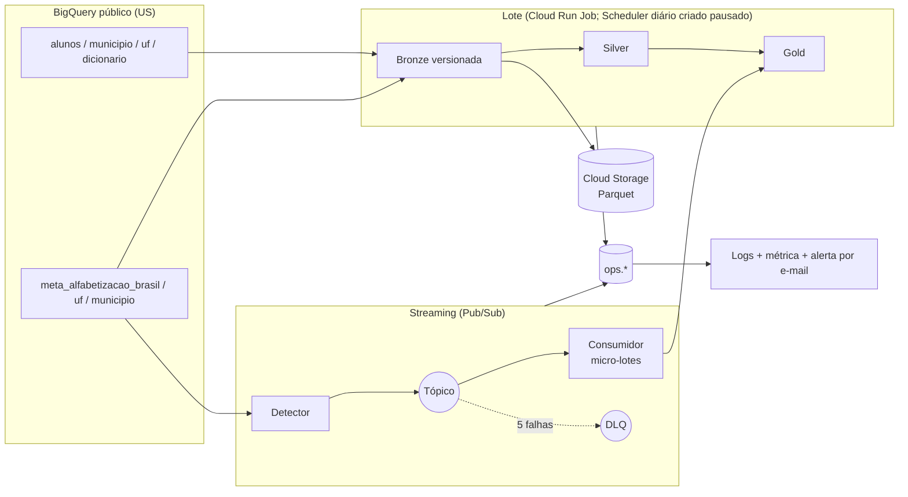

# Radar da Alfabetização

Pipeline híbrido (lote + streaming) sobre os dados oficiais do INEP para acompanhar o indicador
**Criança Alfabetizada** (Saeb, corte de proficiência 743) frente à meta de **80% em 2030** na rede pública.

> Entregável da Fase 2 do Tech Challenge (FIAP Pós Tech, *AI Scientist*).
> Fonte: `basedosdados.br_inep_avaliacao_alfabetizacao` (BigQuery, região US).

## Contexto do problema

O Compromisso Nacional Criança Alfabetizada mobiliza União, estados e municípios para que as crianças estejam
alfabetizadas ao fim do 2º ano do ensino fundamental. A Pesquisa Alfabetiza Brasil (Inep, 2023) fixou o ponto de
corte de **743 pontos** na escala do Saeb; o **Indicador Criança Alfabetizada** é o percentual de estudantes que
atingem esse patamar. A aspiração é universalizar até 2030, e as tabelas oficiais trazem uma trajetória pactuada
ano a ano (2024 a 2030; na rede pública, a meta de 2030 é 80).

Este projeto responde duas perguntas de quem decide política pública: **onde agir primeiro** e **se pode confiar nos
números**. Para isso integra as seis entidades do dataset (alunos, município, UF e as metas do Brasil, das UFs e dos
municípios), calcula o resultado frente à **meta pactuada da fonte** e mede a confiança de cada número. O cenário
aspiracional de 100% não é misturado ao indicador oficial.

## Onde encontrar cada entregável

| Item | Onde |
|---|---|
| Código-fonte dos pipelines | [`src/`](src) (núcleo, adaptadores e CLI) e [`sql/`](sql) (todo o SQL das camadas) |
| Camadas Bronze, Silver e Gold | [`sql/bronze`](sql/bronze), [`sql/silver`](sql/silver), [`sql/gold`](sql/gold) |
| Scripts de validação e qualidade | [`config/rules.yaml`](config/rules.yaml), [`config/sources.yaml`](config/sources.yaml), [`src/radar_alfabetizacao/quality/`](src/radar_alfabetizacao/quality) |
| Documentação técnica | [`docs/arquitetura.md`](docs/arquitetura.md), [`docs/adr/`](docs/adr), [`docs/anomalias.md`](docs/anomalias.md), [`docs/fase1/medicao-fonte.md`](docs/fase1/medicao-fonte.md), [`docs/ia-fase3.md`](docs/ia-fase3.md) |
| **Prints das telas do console (BigQuery, Cloud Run, Pub/Sub, Logging, Monitoring, Storage, e-mail do alerta)** | **[`docs/execucao-cloud/`](docs/execucao-cloud)**: abra [`docs/execucao-cloud/README.md`](docs/execucao-cloud/README.md), que exibe cada print agrupado por serviço; os arquivos `.png` estão na mesma pasta |
| Evidências geradas das execuções (IDs de job, linhas, bytes faturados, qualidade, streaming) | [`docs/execucao-cloud/evidencias.md`](docs/execucao-cloud/evidencias.md) |
| Tabela de estimativa de custo | seção [FinOps](#finops) e [`docs/finops.md`](docs/finops.md) |
| Infraestrutura como código | [`infra/`](infra) (Terraform) |
| Vídeo executivo | Entregue pela plataforma da escola, junto com o link deste repositório |

## O que o pipeline entrega

| Entrega | Onde |
|---|---|
| Termômetro: resultado × meta de cada município, UF e Brasil, com cinco estados explícitos | `gold.termometro` |
| Validação cruzada: taxa recalculada dos microdados × taxa oficial | `gold.reconciliacao` |
| Anomalias e selo de confiança por município | `gold.indicador_municipal` |
| Base da Fase 3, com atributos e rótulos **separados** (sem vazamento do alvo) | `gold.ml_features`, `gold.ml_labels` |
| Evidência de cada execução (jobs, linhas, bytes, qualidade) | dataset `alfabetizacao_ops` |

Todo dado vem da fonte oficial, **lido em tempo de execução**: o ano mais recente é descoberto na
tabela, então o código roda igual quando 2025, 2026 ou 2027 chegarem. Nenhum dado simulado entra
no Gold (ver [Falhas injetadas](#falhas-injetadas-e-dados-simulados)).

## Arquitetura



O diagrama mostra o que foi implementado e executado. Os jobs rodaram sob demanda (`gcloud run jobs execute`); os
agendamentos do Cloud Scheduler existem no Terraform, mas nascem **pausados** (ver [Limitações](#limitações-conhecidas)).
Detalhes e diagramas de sequência em [`docs/arquitetura.md`](docs/arquitetura.md). Cada decisão
tem um registro em [`docs/adr/`](docs/adr).

## Tecnologias utilizadas

| Tecnologia | Papel | Por que | Situação |
|---|---|---|---|
| BigQuery (US) | Fonte, Bronze, Silver, Gold, `ops` e processamento em SQL | A fonte já é nativa no BigQuery: junta sem cópia e sem transferência | Implementado e executado |
| Cloud Storage (Parquet + Snappy) | Arquivo imutável de cada versão da Bronze | Armazenamento barato, colunar e comprimido; permite reprocessar sem reler a fonte | Implementado e executado |
| Pub/Sub (tópico, DLQ, 2 assinaturas) | Mensageria do streaming | Entrega *at-least-once*, reentrega e fila de mensagens mortas prontas | Implementado e executado |
| Cloud Run Jobs | Execução do lote, do detector e do consumidor | Paga só enquanto roda; sem servidor ligado | Implementado e executado |
| Cloud Scheduler | Disparo periódico dos três jobs | Agendamento nativo, sem orquestrador pago | Criado no Terraform, **pausado** (não executou sozinho) |
| Cloud Logging + Monitoring | Log estruturado, métrica `radar_run_failed`, alerta por e-mail | Alerta nativo, sem ferramenta externa | Implementado e executado |
| Terraform | Toda a infraestrutura como código | Ambiente recriável por um comando, com diff revisável | Implementado e executado |
| Python 3.11, Jinja, `pytest`, `ruff`, `mypy --strict` | Núcleo, SQL parametrizado e testes | Núcleo puro e testável sem nuvem | Implementado; `make check` passa |
| Backend remoto do Terraform | Estado compartilhado | Hoje o estado é local (entrega única) | **Evolução futura** |
| Orquestrador (Composer/Airflow) ou Dataflow | Dependências entre etapas; streaming em maior escala | Desnecessários para este volume (ver ADR 0008) | **Evolução futura**, se o volume crescer |
| Painel (por exemplo Looker Studio) sobre a Gold | Consumo pelos gestores | A Gold já está pronta para isso | **Evolução futura** |
| Treino do modelo preditivo | Fase 3 | A base de atributos e rótulos já está entregue | **Próxima fase** |

## Decisões principais

| Decisão | Por quê | ADR |
|---|---|---|
| Bronze **append-only**, versionada pela fonte (`_source_version`) | Auditoria e reprocessamento; rodar de novo sem mudança na fonte não duplica nem custa | [0002](docs/adr/0002-bronze-versionada.md) |
| Streaming **real**: o detector publica as linhas oficiais das tabelas de meta quando elas mudam | Evento = fato publicado pelo INEP, não dado inventado | [0003](docs/adr/0003-streaming-real.md) |
| Um único `MERGE` alimenta o Termômetro (lote e stream) | A regra de status existe em um lugar só | [0004](docs/adr/0004-merge-unico.md) |
| `ack` do Pub/Sub **depois** do commit transacional | Entrega *at-least-once* com idempotência: falha antes do commit = reentrega | [0003](docs/adr/0003-streaming-real.md) |
| Qualidade como regras SQL declarativas; o gate grava a evidência **antes** de bloquear | Reprovação também precisa de prova | [0005](docs/adr/0005-qualidade-declarativa.md) |
| Núcleo puro + portas/adaptadores | Testável sem nuvem | [0006](docs/adr/0006-portas-e-adaptadores.md) |
| FinOps calculado de **medições** reais | Custo projetado sem chute | [0007](docs/adr/0007-finops-medido.md) |
| Cloud Run Jobs + Scheduler, sem Composer/Dataflow | Custo próximo de zero para este volume | [0008](docs/adr/0008-cloud-run-jobs.md) |
| Features e rótulos da Fase 3 em tabelas separadas | Evita vazamento do alvo | [0009](docs/adr/0009-features-e-rotulos.md) |

### Trade-offs

| Tema | Escolha e consequência |
|---|---|
| Batch × streaming | O lote carrega o histórico e as tabelas de resultado, que mudam poucas vezes por ano. O streaming propaga só atualizações de metas. Streaming em tudo custaria mais sem ganho analítico (comparação na seção [Ingestão híbrida](#batch--streaming-o-que-muda)). |
| Data lake × data warehouse | **Híbrido, com o warehouse como verdade.** O BigQuery guarda Bronze, Silver e Gold e faz o processamento. O Cloud Storage (Parquet) é o arquivo imutável de cada versão da Bronze, usado para auditoria e reprocesso. Não há lake com motor próprio: seria um segundo sistema para governar. |
| Custo × desempenho | SQL no BigQuery em vez de Spark/Dataflow, e Cloud Run Jobs em vez de Composer: custo próximo de zero, ao preço de menos paralelismo. Para milhões de linhas, o BigQuery é suficiente. |
| Forma de acesso à fonte | BigQuery nativo, em vez de baixar arquivos (detalhes na subseção abaixo). |

## Ingestão híbrida

**Lote.** `radar batch` compara a versão da fonte (hash de última modificação, linhas e bytes de
cada tabela nativa) com `ops.source_versions`. Sem mudança, termina em segundos com custo mínimo.
Com mudança: nova versão na Bronze (BigQuery + Parquet/Snappy no Cloud Storage), Silver, Gold e
os três gates de qualidade. As versões só são marcadas como processadas depois que Silver e Gold
passam; uma falha no meio é refeita na execução seguinte.

**Streaming.** `radar detect` lê as tabelas de meta (Brasil, UF, município) quando a fonte muda e
publica um evento por linha nova. O `event_id` é o hash do conteúdo: o mesmo fato republicado é
duplicata; valor oficial alterado vira evento novo. `radar consume` puxa micro-lotes, valida cada
mensagem (todos os motivos de rejeição são registrados), grava tudo em `bronze.stream_events`
(a view `bronze.stream_quarantine` mostra as inválidas) e integra as válidas por uma transação
(livro-razão `silver.stream_events` + `MERGE` no `gold.termometro`). A latência medida é a do
pipeline (recebimento menos `publish_time`), com p50 e p95 em `ops.stream_batches`.

### Forma de acesso à fonte

**Escolha: tabelas nativas da Base dos Dados lidas no BigQuery, sem baixar arquivos.**

* **Por quê.** O dataset já está no BigQuery, na região US. Os datasets deste projeto também ficam em US
  (ADR [0010](docs/adr/0010-regiao-us.md)), então a junção entre fonte e Bronze não cruza regiões nem nuvens.
  Como as tabelas são nativas, os metadados (última modificação, linhas e bytes) são confiáveis para detectar mudança
  sem ler os dados ([`docs/fase1/medicao-fonte.md`](docs/fase1/medicao-fonte.md)).
* **Custo.** A leitura é faturada por **bytes escaneados**, na conta do projeto: uma varredura completa de `alunos`
  custa cerca de 256 MiB, e a exploração inicial inteira somou cerca de 352 MiB faturados (0,03% da franquia
  mensal de 1 TiB). **Não há custo de transferência (egress):** fonte e destino estão na mesma região. Baixar
  arquivos exigiria hospedá-los (armazenamento duplicado), mover dados para fora do Google Cloud (egress) se o
  destino fosse outra nuvem, e reimplementar a detecção de mudança.
* **Quando a fonte é atualizada.** `radar batch` calcula `source_version` (hash de última modificação, linhas e
  bytes). Versão nova entra na Bronze **sem apagar a anterior** (`INSERT ... WHERE NOT EXISTS`), é exportada em
  Parquet, e a Silver e a Gold são recalculadas a partir da versão vigente. Versão igual: o job termina em segundos
  e só consulta metadados. O ano mais recente é descoberto na tabela (`MAX(ano)`), sem ano fixo no código.

### Batch × streaming: o que muda

| Aspecto | Lote (`radar batch`) | Streaming (`radar detect` + `radar consume`) |
|---|---|---|
| O que processa | Histórico completo: alunos, município, UF, metas e dicionário | Uma mensagem por linha de meta nova ou alterada (Brasil, UF, município) |
| Frequência | Diária (06:00, no Terraform) ou sob demanda | Detector a cada 6 h e consumidor a cada 30 min no Terraform; ambos rodaram sob demanda |
| Latência | Horas: depende do agendamento | Segundos por micro-lote, **medida** em `ops.stream_batches` (`latency_p50/p95_seconds`) |
| Garantias | Idempotência por versão da fonte | *At-least-once* com idempotência por `event_id` (hash do conteúdo) |
| Evento inválido | Gate de qualidade bloqueia a Gold | Quarentena com todos os motivos de rejeição |
| Evento duplicado | Não se aplica: versão repetida é ignorada | Ignorado pelo livro-razão, sem alterar a Gold |
| Falha no meio | Versão não é marcada como processada; refeita na execução seguinte | Sem `ack` até o commit: o Pub/Sub reentrega; após 5 tentativas, vai para a DLQ |

A latência medida é a do **pipeline** (recebimento menos `publish_time`). Como o detector publica fatos oficiais já
existentes na fonte, não existe um instante de produção anterior a medir. Na carga inicial (~10,8 mil eventos
publicados de uma vez), a latência cresce de lote em lote porque a fila acumula; ver [`docs/arquitetura.md`](docs/arquitetura.md).

## Arquitetura Medalhão

| Camada | Conteúdo | Regras principais |
|---|---|---|
| **Bronze** (`alfabetizacao_bronze`) | Cópia fiel de cada tabela da fonte + `_run_id`, `_source_version`, `_ingested_at`; absorve colunas novas da fonte | contagem de linhas igual à fonte |
| **Silver** (`alfabetizacao_silver`) | Tipos corretos, chaves únicas, domínios válidos, UF derivada do código IBGE, `avaliado`, redes descritas pelo dicionário, metas por ano em colunas padronizadas | unicidade, nulos, domínio, coerência com o corte 743, *join rates* |
| **Gold** (`alfabetizacao_gold`) | Termômetro, reconciliação, indicador municipal, `ml_features`, `ml_labels` | status válido, nulo nunca vira zero, sem vazamento temporal |

**Política de escrita da Bronze:** *append-only* por versão da fonte. Uma execução nunca apaga nem sobrescreve a
anterior; versão já existente não é regravada (ADR [0002](docs/adr/0002-bronze-versionada.md)).

Estados do Termômetro (mutuamente exclusivos): `linha_de_base` (ano anterior a 2024), `sem_resultado`,
`sem_meta`, `atingiu` (taxa ≥ meta; empate conta como atingiu) e `nao_atingiu`. O cenário aspiracional
de 100% **não** é misturado ao indicador oficial.

## Qualidade e validação cruzada

* ~30 regras em [`config/rules.yaml`](config/rules.yaml), cada uma com severidade **bloqueante** ou **informativa**.
* O motor executa **todas** as regras da camada, grava os resultados em `ops.quality_results` e só então bloqueia.
  Regra que não executa **falha fechada**.
* Contrato da fonte (`config/sources.yaml`): coluna ausente ou tipo alterado bloqueia; coluna nova é informativa.
* **Validação cruzada:** `gold.reconciliacao` recalcula a taxa dos microdados (ponderada por `peso_aluno`, entre
  avaliados, proficiência ≥ 743; rede 5 = redes 2+3) e compara com a oficial em município, UF e Brasil.
* **Anomalias** (`docs/anomalias.md`): sem microdados, amostra pequena (< 30), divergência > 1 p.p., queda ≥ 15 p.p.
  O selo de confiança (`alta/media/baixa`) resume isso em `gold.indicador_municipal`.

## Monitoramento

O que é monitorado e onde está o dado (tudo persiste em BigQuery e Cloud Logging, não só no terminal):

| Monitoramento esperado | Como é feito | Onde ver |
|---|---|---|
| Falhas de ingestão | Log JSON `event="run_failed"` em toda falha; mensagens inválidas do streaming vão para quarentena | Cloud Logging; view `bronze.stream_quarantine` |
| Latência do pipeline | Duração por etapa; latência p50/p95 de cada micro-lote do streaming | `ops.steps.duration_seconds`; `ops.stream_batches` |
| Volume de dados processados | Linhas afetadas, bytes processados e faturados por etapa | `ops.steps` |
| Qualidade | Resultado de cada regra, inclusive as reprovadas | `ops.quality_results` |
| Alertas de erro | Métrica `radar_run_failed` + política "Radar: execução falhou" com e-mail ([`infra/monitoring.tf`](infra/monitoring.tf)) | Cloud Monitoring; e-mail |

As tabelas operacionais são **acumuladas** (uma linha por execução e etapa, nunca sobrescritas): `runs`, `steps`
(com `job_id`), `quality_results`, `source_versions`, `stream_batches`.

**Em produção, quem descobre que o pipeline quebrou, e em quanto tempo?** O destinatário configurado em
`alert_email` recebe um e-mail. A política abre um incidente quando a métrica `radar_run_failed` soma mais que 0 em
uma janela de 300 s. No teste de 03/11/2026, a falha injetada foi registrada às 16:08:59 (UTC−4) e o incidente
abriu às 20:09 UTC, **no mesmo minuto**. O e-mail chegou à caixa configurada (print `07-alerta-email.png`). O alerta
só cobre falhas que emitem o log `run_failed`; ver as limitações abaixo.

**Demonstração do pipeline falhando:** `radar batch --demo-gate-failure` injeta uma regra bloqueante reprovada.
O Gold **não** é publicado, a evidência fica gravada e o alerta dispara. A execução falhou de verdade em 03/11/2026
(prints `04-logging-run-failed.png` e `07-alerta-email.png`, em [`docs/execucao-cloud/`](docs/execucao-cloud)).

## FinOps

Projeção mensal a partir de quantidades **medidas** (bytes faturados por execução, armazenamento real, tamanho do
bucket, volume de mensagens) e preços de lista em [`config/finops_prices.yaml`](config/finops_prices.yaml).
Gerada por `make finops`, que atualiza o bloco abaixo e `docs/finops.md`.

<!-- FINOPS:START -->
| Serviço | Unidade | Quantidade medida | Preço unitário | Custo mensal projetado |
|---|---|---|---|---:|
| BigQuery: análise (on-demand) | TiB processados/mês | 0.002626 TiB (2888 MB) projetados a partir de execuções medidas | US$ 6.25/TiB; 1 TiB/mês grátis | US$ 0.0000 |
| BigQuery: armazenamento | GiB-mês (lógico) | 0.751 ativo + 0.000 longo prazo, medidos | US$ 0.023/GiB ativo; 10 GiB/mês grátis | US$ 0.0000 |
| Cloud Storage: Bronze Parquet | GiB-mês | 0.074 GiB, medidos no bucket | US$ 0.02/GiB (us-central1); 5 GiB/mês grátis | US$ 0.0000 |
| Pub/Sub: mensagens | GiB trafegados/mês | 0.0096 GiB (volume medido x2: publicação e entrega) | US$ 40/TiB; 10 GiB/mês grátis | US$ 0.0000 |
| Cloud Run Jobs | vCPU-s e GiB-s/mês | 36998 vCPU-s e 36998 GiB-s projetados a partir de durações medidas | US$ 1.8e-05/vCPU-s e US$ 2e-06/GiB-s; franquia mensal | US$ 0.0000 |
| Cloud Scheduler | jobs agendados | 3 jobs | US$ 0.1/job; 3 grátis | US$ 0.0000 |
| **Total** | | | | **US$ 0.0000** |

Sem nenhuma franquia gratuita (pior caso), a projeção seria **US$ 1.0755/mês**.
Nos últimos 30 dias, o pipeline faturou 10399.8 MB de análise no BigQuery (todos os jobs rotulados `app=radar-alfabetizacao`).
<!-- FINOPS:END -->

A tabela segue o formato pedido (serviço, unidade, quantidade medida, preço unitário, custo mensal projetado). O
ambiente de execução é um projeto individual, dentro das franquias gratuitas; por isso a projeção considera as
franquias e, logo abaixo da tabela, mostra o **pior caso sem nenhuma franquia**. O cronograma de execução projetado
está em `config/finops_prices.yaml`.

Controles de custo: consultas só sobre colunas necessárias; `ano` filtrado cedo; lote sem mudança não reprocessa;
jobs rotulados (`app`, `run_id`, `step`) para atribuir custo; agendamentos nascem **pausados**; sem Composer/Dataflow.

## Como reproduzir (Cloud Shell)

Pré-requisitos: um projeto GCP com faturamento e `gcloud` (já vem no Cloud Shell). O `make deploy` instala o
Terraform em `~/bin` se ele não estiver disponível.

```bash
git clone https://github.com/GisellyOliveira/TechChallenge-FIAP02.git && cd TechChallenge-FIAP02
export RADAR_PROJECT_ID="$(gcloud config get-value project)"
export RADAR_BUCKET="${RADAR_PROJECT_ID}-alfabetizacao-bronze"
cp infra/terraform.tfvars.example infra/terraform.tfvars   # ajuste project_id, bucket_name, alert_email

python -m venv .venv && . .venv/bin/activate
make install && make check          # lint, tipos estritos e testes (sem nuvem)

make deploy                          # Terraform + build da imagem + Cloud Run Jobs
gcloud run jobs execute radar-batch  --region us-central1 --wait
gcloud run jobs execute radar-detect --region us-central1 --wait
gcloud run jobs execute radar-consume --region us-central1 --wait

radar inject-faults && radar consume   # quarentena e duplicatas (origem=simulado)
radar batch --demo-gate-failure || true # bloqueio do gate + alerta
radar batch                             # segunda execução: fonte inalterada, custo mínimo

make evidence                        # docs/execucao-cloud/evidencias.md
make finops                          # docs/finops.md + tabela deste README
```

Nenhuma credencial é versionada: a autenticação usa *Application Default Credentials* e a conta de serviço
`radar-runner` (privilégio mínimo). Para ligar os agendamentos: `terraform -chdir=infra apply -var scheduler_enabled=true -var create_jobs=true`.

## Evidências de execução na nuvem

Projeto GCP `dados-basedosdados`, região US (Cloud Run e bucket em `us-central1`). Tudo foi executado de verdade.

* **Prints das telas do console:** pasta [`docs/execucao-cloud/`](docs/execucao-cloud). A página
  [`docs/execucao-cloud/README.md`](docs/execucao-cloud/README.md) mostra todos os prints, agrupados por serviço.
* **Evidências geradas a partir do próprio BigQuery** por `make evidence`, em
  [`docs/execucao-cloud/evidencias.md`](docs/execucao-cloud/evidencias.md): IDs de job, linhas afetadas, bytes
  faturados, resultados de qualidade, lotes de streaming e contagem de linhas por tabela.

| Serviço | Arquivos em `docs/execucao-cloud/` | O que prova |
|---|---|---|
| BigQuery | `01-bigquery-datasets.png`, `01a` a `01e-bigquery-*.png` | Os quatro datasets e as tabelas de Bronze, Silver, Gold e Ops |
| Cloud Run | `02-cloud-run-jobs.png`, `02-cloud-run-batch-execucoes.png` | Os três jobs e execução concluída do `radar-batch` |
| Pub/Sub | `03-pubsub-topicos.png`, `03-pubsub-assinaturas.png` | Tópico de eventos, DLQ e assinaturas |
| Cloud Logging | `04-logging-run-failed.png` | Falha do gate de qualidade registrada como `run_failed` |
| Cloud Monitoring | `05-monitoring-politica.png` | Política de alerta "Radar: execução falhou" |
| Cloud Storage | `06-storage-parquet.png` | Bronze em Parquet, uma pasta por versão da fonte |
| E-mail | `07-alerta-email.png` | Alerta recebido após a falha injetada |

## Falhas injetadas e dados simulados

`radar inject-faults` publica **somente** mensagens inválidas ou duplicadas, sempre com o atributo
`origem=simulado`, para demonstrar quarentena e deduplicação. Nenhuma mensagem simulada válida entra no Gold,
e a regra informativa `gold.termometro.sem_dados_simulados` registra a conferência.

## Aplicação em IA

A Gold foi desenhada para ser a base de modelos e de análises de política pública:

* **Predição de alfabetização.** Dado o que se sabe de cada município e rede no ano *t* (taxa, meta, distância até a
  meta, níveis de proficiência), prever se o município atingirá a meta no ano *t+1* (Fase 3).
* **Desigualdade educacional.** O termômetro compara município, UF e Brasil na mesma rede e ano, e o selo de confiança
  mostra onde o número é frágil, para priorizar quem está mais distante da meta.
* **Políticas baseadas em evidência.** A validação cruzada e as anomalias documentadas deixam claro quanto cada
  número pode sustentar uma decisão.

### Fase 3 (modelo preditivo): atenção a vazamento

* `ml_features` tem somente informação conhecida no ano de referência *t* (inclui a meta do ano seguinte, pactuada antes).
* `ml_labels` tem o alvo do ano *t+1* (`atingiu_meta_alvo`) e o `split_sugerido` **temporal**.
* A regra bloqueante `gold.ml.sem_vazamento_temporal` garante que todo par atributo/rótulo respeite `ano_referencia = ano_alvo − 1`.
* Hoje existe **uma** transição observável (2023 → 2024); com poucos anos, a Fase 3 deve declarar essa limitação.
  Detalhes em [`docs/ia-fase3.md`](docs/ia-fase3.md).

## Testes e qualidade de código

`make check` executa `ruff`, `mypy --strict` e `pytest`. Os testes cobrem regras de negócio, contrato, motor de
qualidade, consumidor (ordem commit → ack), detector, FinOps, CLI, adaptadores (com clientes simulados), validação
estática do Terraform e **todo o SQL** (renderização + análise sintática BigQuery). A regra de status e a taxa
ponderada têm teste de paridade SQL × Python em DuckDB. A CI (`.github/workflows/ci.yml`) também roda
`terraform validate` e `gitleaks`.

## Limitações conhecidas

**O que ficou de fora ou não foi executado**

* Os agendamentos do Cloud Scheduler existem no Terraform, mas ficaram **pausados**: todas as execuções na nuvem foram
  disparadas sob demanda. O pipeline não foi observado rodando sozinho por dias.
* O alerta cobre falhas que emitem `run_failed`. Uma execução que não chega a registrar o log (por exemplo, o contêiner
  encerrado por falta de memória) ou um job que simplesmente não roda não gera alerta. Um alerta sobre o status de
  execução do Cloud Run e um alerta de ausência de execução são evolução futura.
* O estado do Terraform é local (projeto de entrega única); em produção usaria *backend* remoto.
* Não há painel de consumo: a Gold está pronta para um, mas nenhum foi construído.
* O SQL é validado sintaticamente na CI e executado de verdade no BigQuery (ver evidências).

**O que foi simulado**

* Só as mensagens defeituosas e duplicadas do streaming (`radar inject-faults`), sempre com `origem=simulado`, para
  demonstrar quarentena e deduplicação. Nenhum dado simulado entra no Gold.

**Lacunas da fonte**

* As tabelas de resultado e os microdados terminam em 2024; as metas chegam a 2025. Existe **uma** transição observável
  (2023 → 2024), o que limita qualquer modelo da Fase 3. Projeção até 2030 seria cenário, não previsão.
* Nos microdados de 2023 não aparecem SP, AC e DF. O recálculo nacional de 2023 dá 57,46 contra 55,9 oficial, e a
  hipótese principal é essa ausência. O pipeline mede e registra a diferença, sem corrigi-la
  ([`docs/anomalias.md`](docs/anomalias.md)).
* Há municípios sem meta e um estado sem resultado em 2024 (Roraima); eles recebem estados explícitos (`sem_meta`,
  `sem_resultado`), nunca zero.
* A reprodutibilidade usa faixas de versão nas dependências (`pyproject.toml`), sem arquivo de bloqueio.

## Estrutura

```
config/   contrato de dados, regras de qualidade, preços FinOps
sql/      todo o SQL (Jinja): ddl, bronze, silver, gold, stream, ops
src/      núcleo (domain, quality, pipeline, ops), portas e adaptadores, CLI
infra/    Terraform: datasets, bucket, Pub/Sub + DLQ, Cloud Run Jobs, Scheduler, alertas
tests/    unitários, SQL, paridade DuckDB, Terraform
docs/     arquitetura, ADRs, anomalias, medição da fonte (fase1/), Fase 3, evidências e prints (execucao-cloud/)
```
