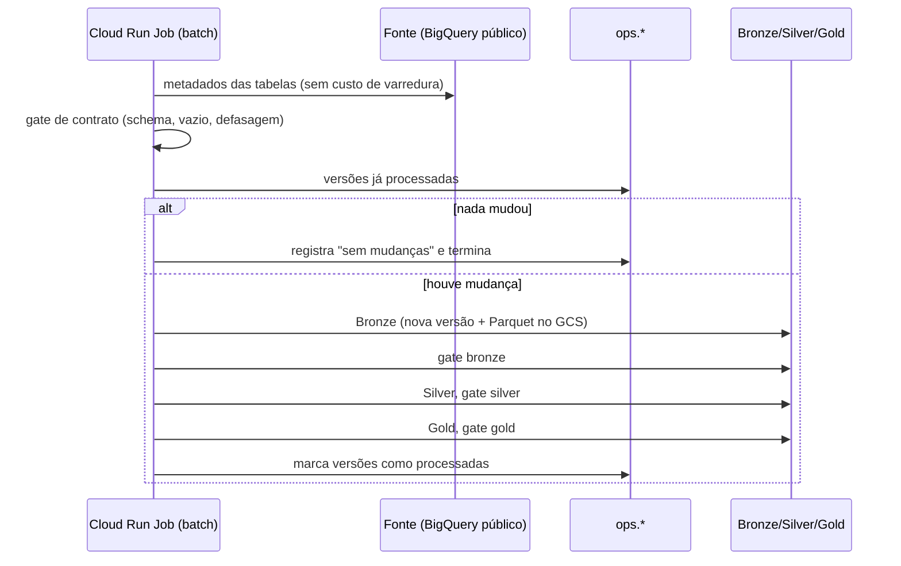
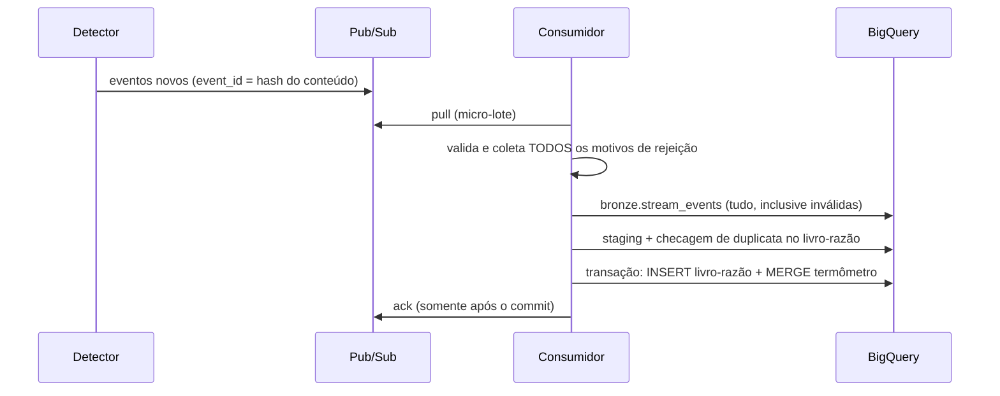

# Arquitetura

## Visão geral

O sistema tem dois caminhos que convergem no mesmo Gold:

* **Lote** (`radar batch`): Bronze versionada → Silver → Gold, uma vez por dia (ou quando a fonte muda).
* **Streaming** (`radar detect` + `radar consume`): linhas oficiais das tabelas de meta viram eventos no Pub/Sub e
  entram no `gold.termometro` em micro-lotes.

Os dois caminhos usam o **mesmo** `MERGE` (`sql/gold/termometro_merge.sql`). Só muda o *template* de origem
(`termometro_source_batch.sql` ou `termometro_source_stream.sql`), então a regra de status é única.

## Lote: sequência



## Streaming: sequência



**Como ler a latência.** `latency_p50/p95_seconds` em `ops.stream_batches` mede o tempo entre a publicação no
Pub/Sub e o recebimento pelo consumidor. Na carga inicial, o detector publica ~10,8 mil eventos de uma vez e o
consumidor os processa em micro-lotes de até 1.000 (cerca de 15 s por lote), então a latência cresce de lote em lote
(fila acumulada, não lentidão por mensagem). Com poucas mensagens, como no lote de falhas injetadas, ela cai para o
nível de segundos. A duração de processamento de cada lote fica em `duration_seconds`.

Garantias: *at-least-once* na entrega, **idempotência** pelo `event_id` e pelo livro-razão, e reentrega
automática se o commit falhar. Após 5 entregas sem `ack`, a mensagem vai para a DLQ.

## Camadas e tabelas

| Camada | Tabela | Observação |
|---|---|---|
| Bronze | `alunos`, `municipio`, `uf`, `dicionario`, `meta_alfabetizacao_*` | append-only, uma versão por mudança da fonte |
| Bronze | `stream_events`, view `stream_quarantine` | toda mensagem recebida, com motivos de rejeição |
| Silver | `alunos`, `municipio`, `uf`, `dicionario`, `meta_brasil/uf/municipio`, `ref_uf` | tipadas e validadas |
| Silver | `stream_events` | livro-razão de deduplicação |
| Gold | `termometro` | resultado × meta (lote + stream) |
| Gold | `reconciliacao` | taxa recalculada × oficial |
| Gold | `indicador_municipal` | termômetro + reconciliação + anomalias + selo |
| Gold | `ml_features`, `ml_labels` | base da Fase 3 |
| Ops | `runs`, `steps`, `quality_results`, `source_versions`, `stream_batches` | evidência e FinOps |

## Código

```
domain/      regras puras (status, taxa ponderada, eventos, território)   — sem I/O
quality/     motor de regras, gates                                       — depende só de portas
pipeline/    batch, detector, consumer, faults                            — orquestra SQL e portas
ops/         recorder, finops, evidence, docs                             — registro e relatórios
adapters/    BigQuery, Pub/Sub, Cloud Storage                             — única parte que fala com a nuvem
cli.py       raiz de composição
```

O SQL fica em arquivos (`sql/`), renderizado por Jinja com `StrictUndefined`: variável ausente é erro.

## Segurança

* Contas de serviço separadas para execução (`radar-runner`) e disparo (`radar-scheduler`), com papéis mínimos.
* Bucket com acesso uniforme e prevenção de acesso público.
* Nenhuma chave em arquivo; `.env` e `*.tfvars` no `.gitignore`; `gitleaks` na CI.
