# Evidências de execução na nuvem

Projeto GCP `dados-basedosdados`, região US (Cloud Run e bucket em `us-central1`). Tudo o que está nesta pasta vem
de execuções reais; nada foi simulado, exceto as mensagens defeituosas do streaming, que levam `origem=simulado`.

* [`evidencias.md`](evidencias.md): gerado por `make evidence` direto das tabelas `alfabetizacao_ops` (job IDs, linhas,
  bytes faturados, qualidade por camada, regras reprovadas, lotes de streaming, contagem de linhas por tabela).
* Os prints do console estão abaixo, na ordem do pipeline.

## BigQuery: Medalhão e registro operacional

Os quatro datasets, criados pelo Terraform (etiqueta `goog-terraform-provisioned`), na região US.

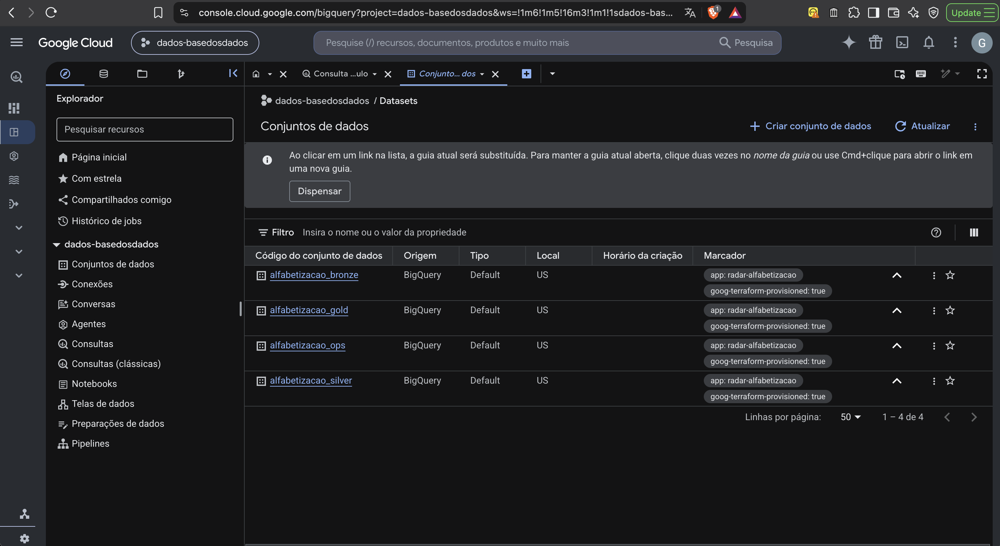

| Camada | Print |
|---|---|
| Bronze: cópia versionada da fonte, `stream_events` e a view de quarentena | 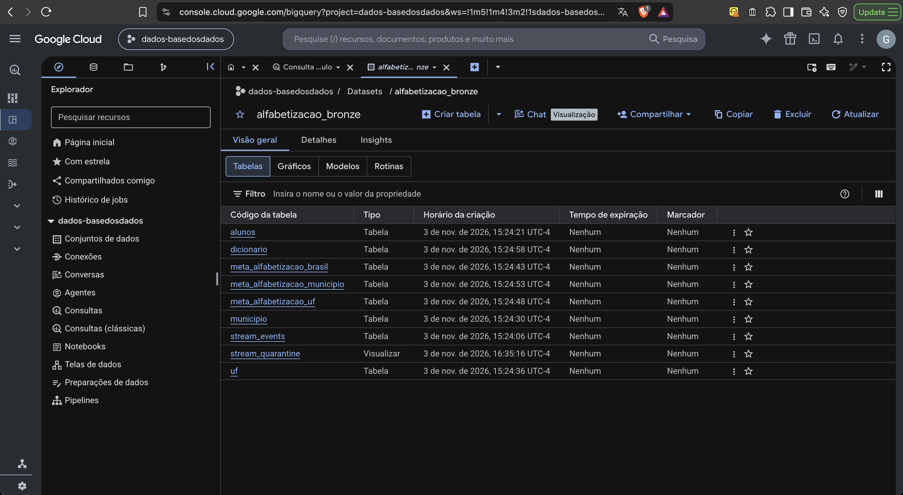 |
| Silver: tabelas tipadas e validadas | 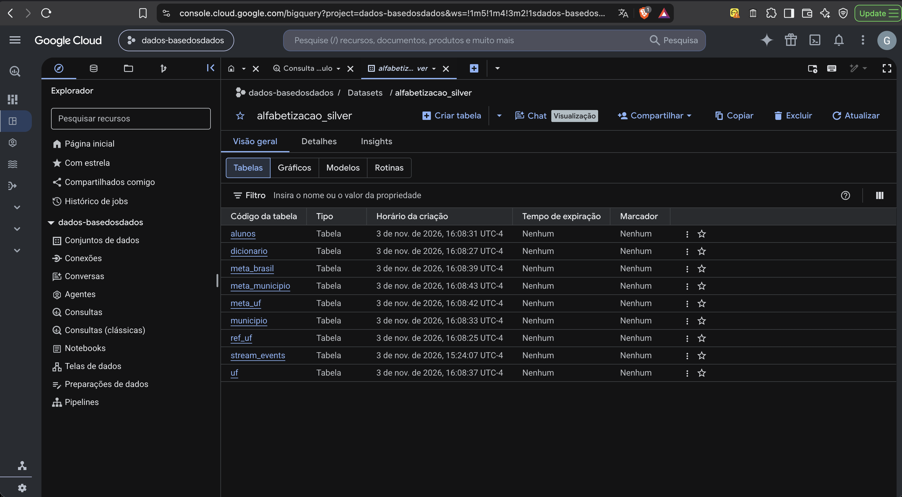 |
| Gold: termômetro, reconciliação, indicador municipal e tabelas para a Fase 3 | 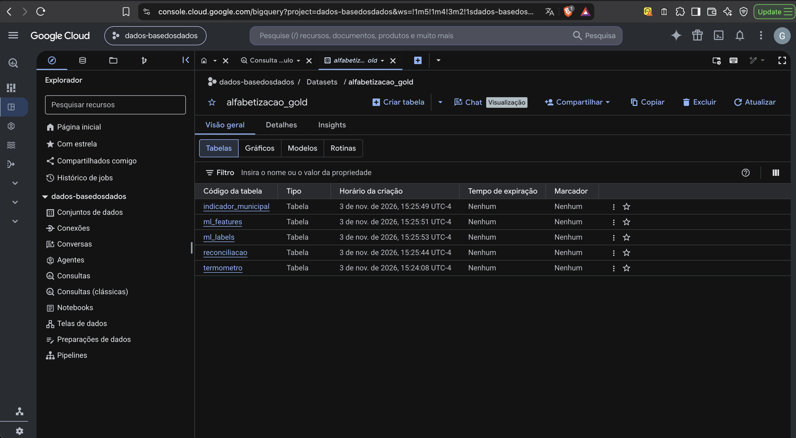 |
| Ops: execuções, passos, regras de qualidade e versões processadas | 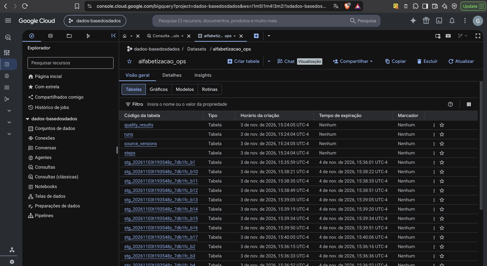 |
| Ops: lotes do streaming (`stream_batches`) e as tabelas temporárias `stg_*`, que expiram em 24 h | 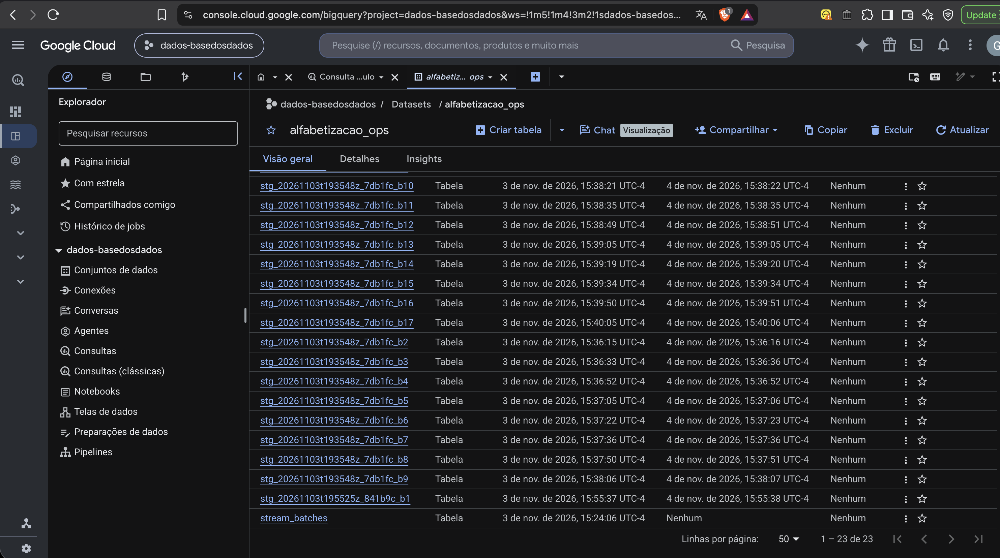 |

## Cloud Run: jobs

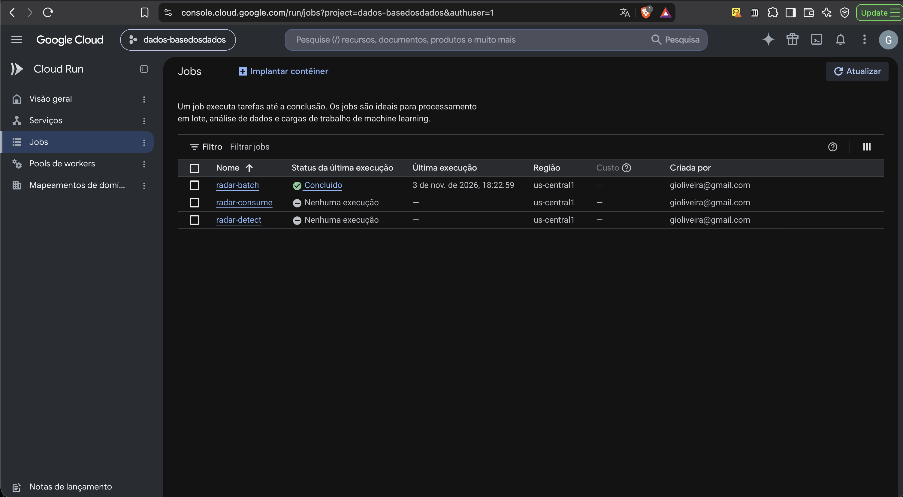

Execução concluída do `radar-batch` (fonte inalterada: `skipped_no_changes`):

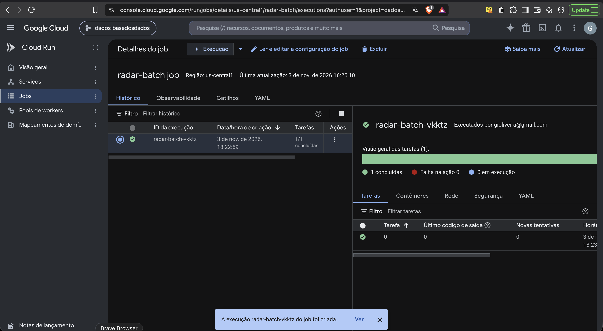

## Pub/Sub: tópicos e assinaturas

Tópico de eventos, tópico de mensagens mortas (DLQ), assinatura do consumidor e assinatura de inspeção da DLQ.

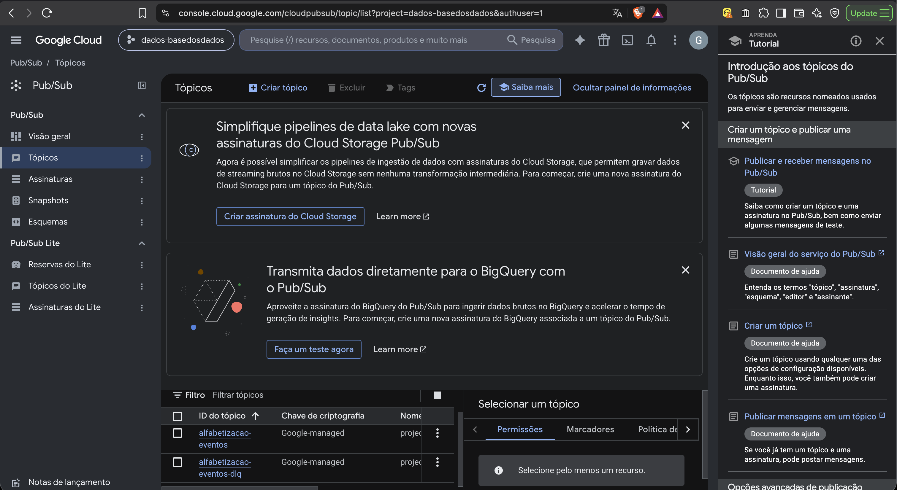

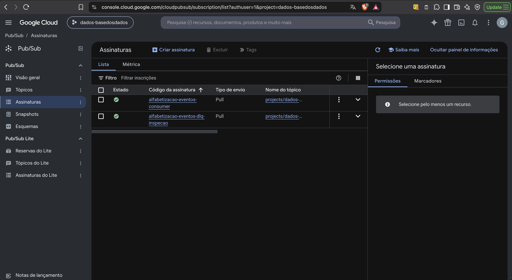

## Cloud Logging: falha do gate de qualidade

Log estruturado `run_failed` da demonstração (`--demo-gate-failure`): o gate bloqueou a Silver e a Gold ficou intacta.

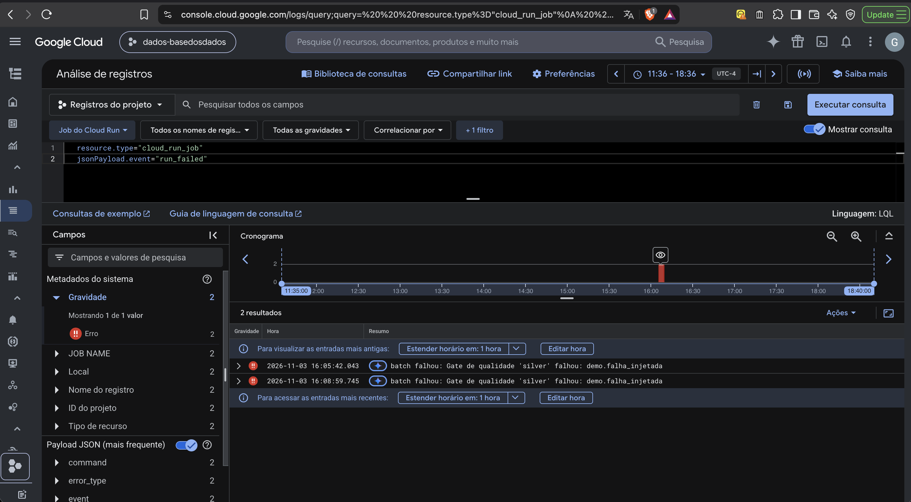

## Monitoring: política e alerta

A política "Radar: execução falhou" é alimentada pela métrica baseada em logs `radar_run_failed`.

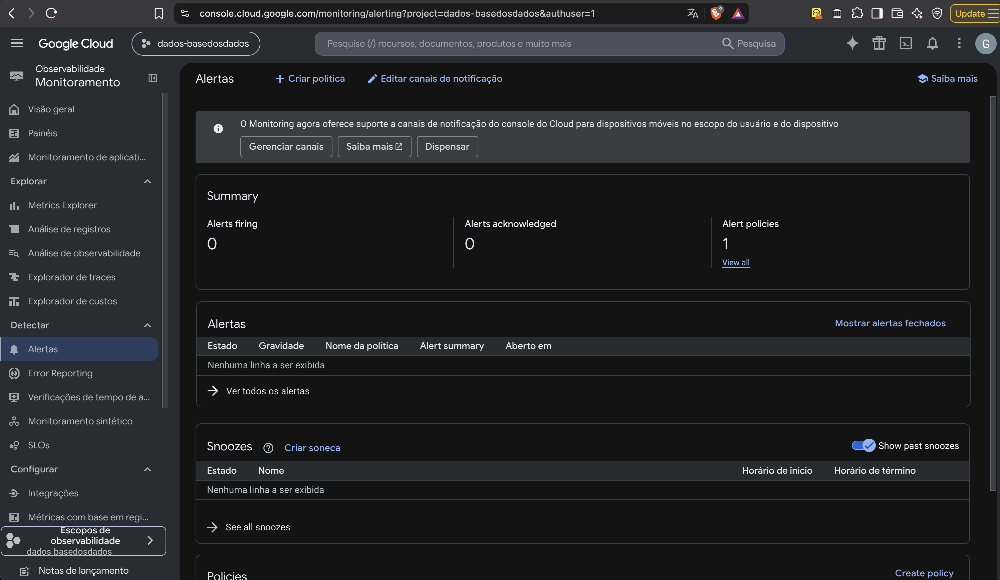

E-mail recebido quando a falha demonstrativa disparou o alerta:

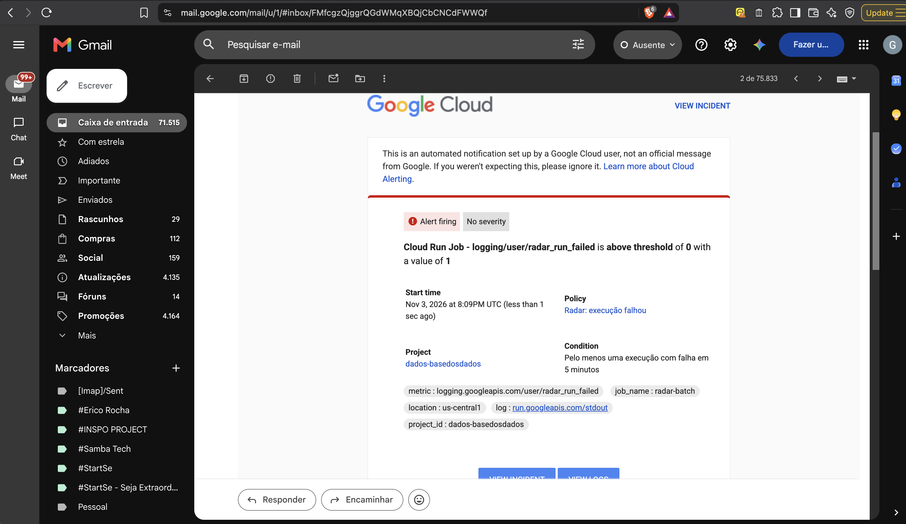

## Cloud Storage: Bronze em Parquet

Um arquivo Parquet por versão da fonte (`source_version`), em `bronze/table=<tabela>/source_version=<hash>/`.

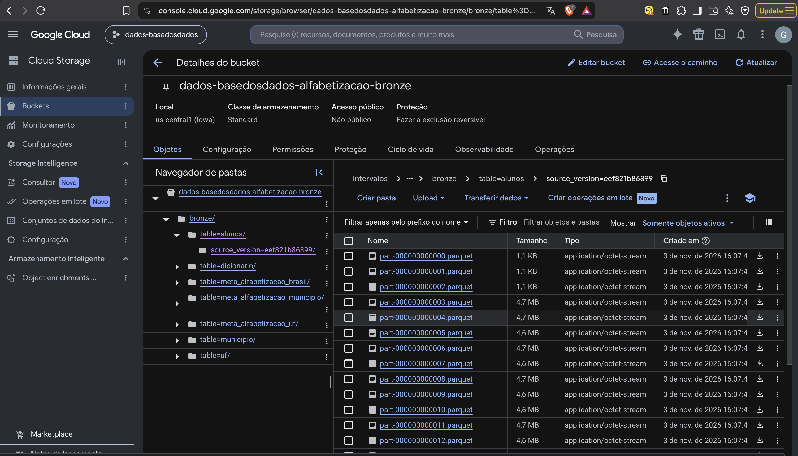
